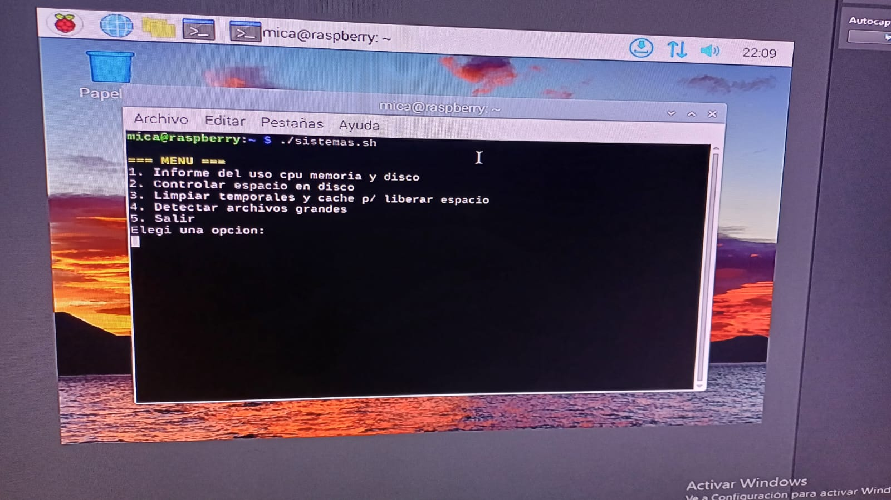
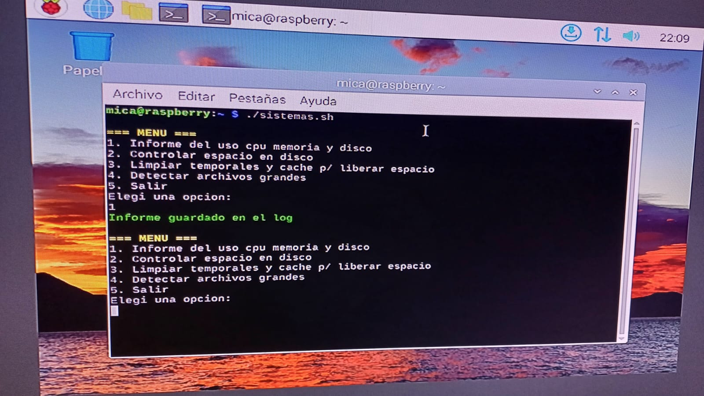
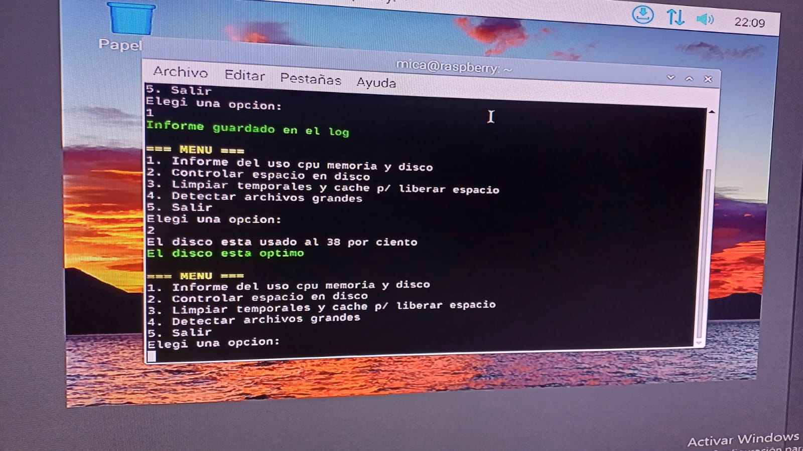
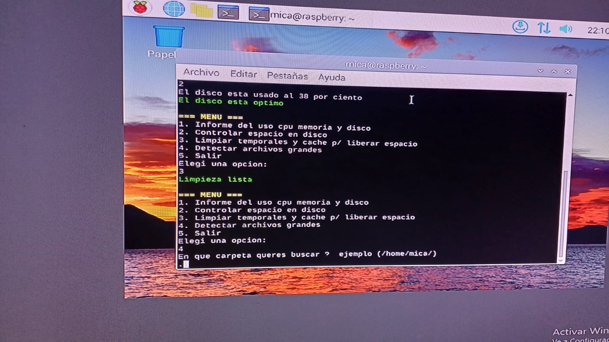
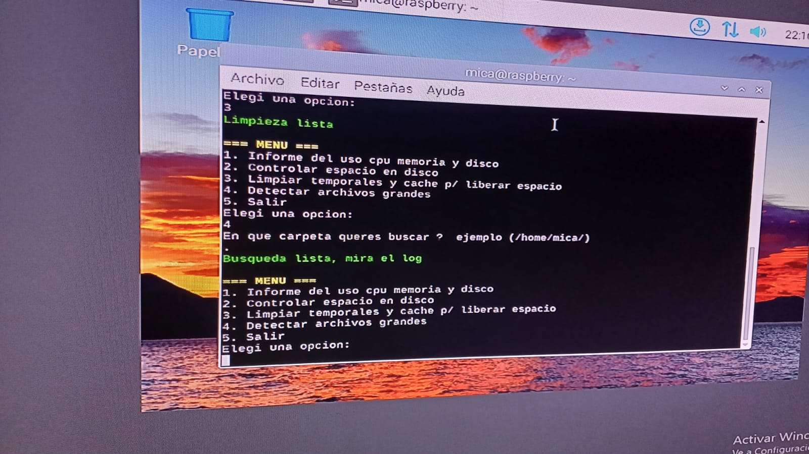
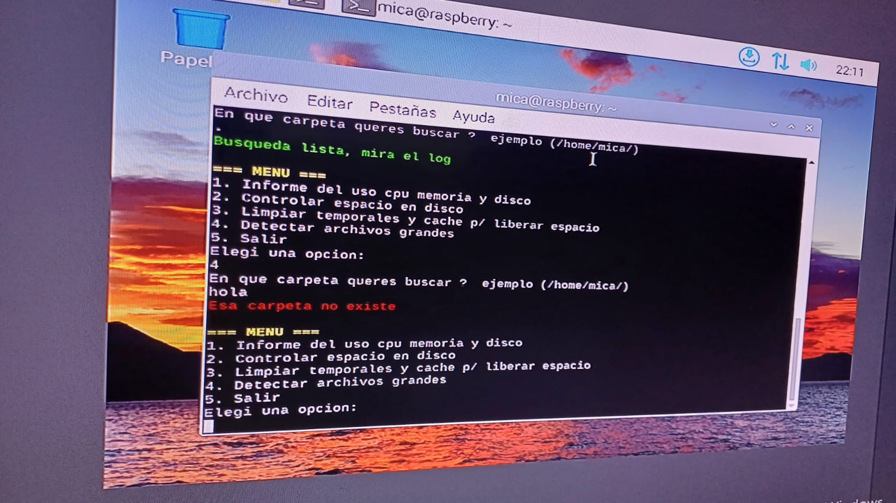
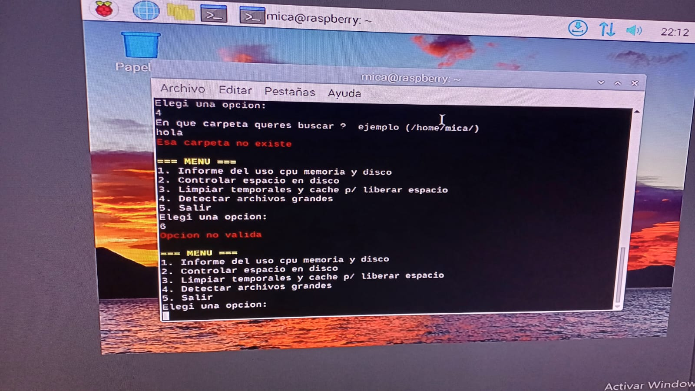
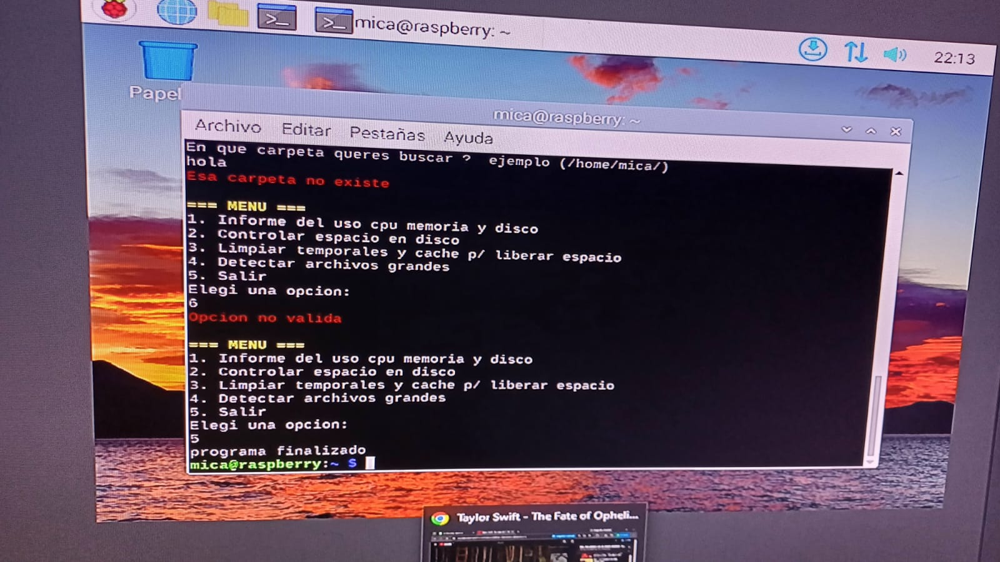
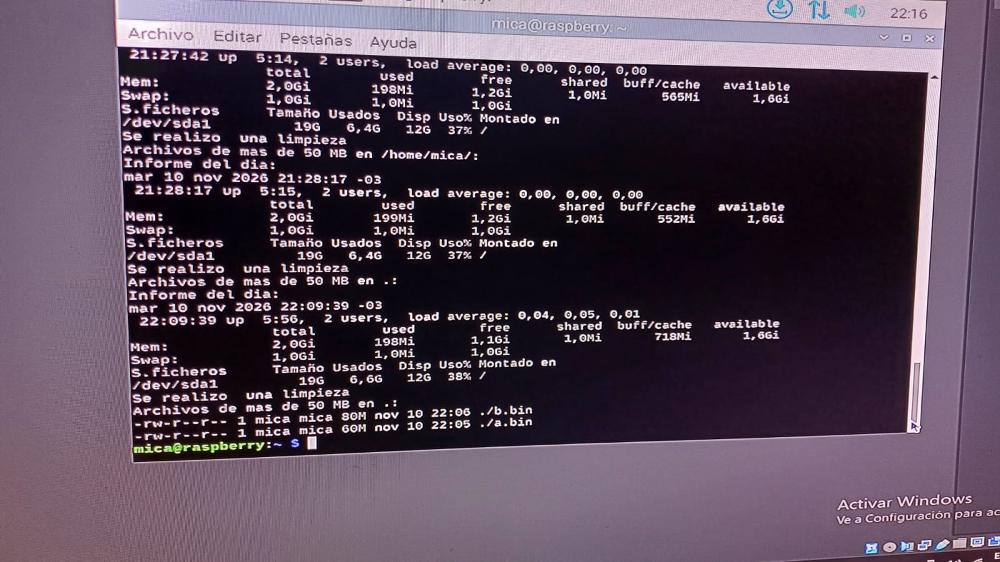

# Memoria Tecnica - Menu de Sistema

Proyecto final, Sistemas Operativos

Alumnas: Dubar Antonella, Villalba Micaela.

## 1. Introduccion

Este proyecto es un script en Bash que presenta un menu interactivo en la
terminal y automatiza cuatro tareas de administracion del sistema. Se
desarrollo y probo en una Raspberry Pi con Raspberry Pi OS.

Tareas automatizadas:

1. Generar un informe con el uso actual de la CPU, memoria y disco, y guardarlo
   en un archivo log.
2. Controlar el espacio disponible en disco, verificar el porcentaje de
   ocupacion de las particiones y generar una alerta en el log cuando se supere
   un umbral configurable.
3. Eliminar archivos temporales, cache del sistema y de navegadores para
   liberar espacio en disco.
4. Detectar archivos grandes, buscar archivos que superen un tamano
   configurable dentro de un directorio y generar un informe ordenado por
   tamano, indicando su ubicacion.

Ademas, en el menu interactivo le agregamos colores, se puede elegir la opcion
que se quiera y tambien se validan las opciones, para que se ingrese una opcion
correcta y, por ultimo, la opcion para salir del menu.

## 2. Requisitos tecnicos

- Sistema Linux con Bash (probado en Raspberry Pi OS).
- Comandos utilizados: `uptime`, `free`, `df`, `find`, `tail`, `tr`, `rm`, `date`.
  Todos vienen instalados por defecto.
- Permiso de escritura en la carpeta personal, donde se crea `sistemas.log`.
- Editor de texto (se uso `nano`).

## 3. Desarrollo

### 3.1 Colores y configuracion

```bash
ROJO='\033[0;31m'
VERDE='\033[0;32m'
AMARILLO='\033[1;33m'
SIN='\033[0m'

LOG=~/sistemas.log
UMBRAL=80
TAMANO=50
```

Las primeras variables guardan los codigos de color. `SIN` vuelve al color
normal. Las ultimas tres son la configuracion: la ruta del log, el umbral de
disco (en porcentaje) y el tamano minimo de archivo grande (en MB). Se pueden
cambiar sin tocar el resto del codigo.

### 3.2 Menu principal

```bash
op=0

while [ "$op" != "5" ]
do
    echo -e "${AMARILLO}=== MENU ===${SIN}"
    echo "1. Informe del uso cpu memoria y disco"
    echo "2. Controlar espacio en disco"
    echo "3. Limpiar temporales y cache p/ liberar espacio"
    echo "4. Detectar archivos grandes"
    echo "5. Salir"
    echo "Elegi una opcion:"
    read op
```

El ciclo `while` repite el menu hasta que el usuario elige la opcion 5.
`read op` guarda en la variable `op` lo que se escribe. `echo -e` permite que
se interpreten los colores.

### 3.3 Tarea 1: informe de CPU, memoria y disco

```bash
echo "Informe del dia:" >> $LOG
date >> $LOG
uptime >> $LOG
free -h >> $LOG
df -h / >> $LOG
```

- `date` agrega la fecha y la hora.
- `uptime` muestra la carga de la CPU.
- `free -h` muestra la memoria RAM.
- `df -h /` muestra el uso de la particion raiz.
- `>>` agrega la salida al final del log sin borrar lo anterior.

### 3.4 Tarea 2: control de disco

```bash
uso=$(df --output=pcent / | tail -1 | tr -d ' %')
if [ "$uso" -gt "$UMBRAL" ]
then
    echo -e "${ROJO}ALERTA: disco casi lleno${SIN}"
    echo "ALERTA: disco al $uso por ciento" >> $LOG
else
    echo -e "${VERDE}El disco esta optimo ${SIN}"
fi
```

`df --output=pcent /` devuelve el porcentaje usado. `tail -1` se queda con la
ultima linea y `tr -d ' %'` le quita el espacio y el simbolo `%` para que quede
solo el numero. Con `-gt` (mayor que) se compara contra el umbral. Si lo
supera, se muestra una alerta en rojo y se guarda en el log.

### 3.5 Tarea 3: limpieza

```bash
rm -f /tmp/*.tmp
rm -rf ~/.cache/mozilla
rm -rf ~/.cache/chromium
rm -rf ~/.cache/google-chrome
echo "Se realizo una limpieza" >> $LOG
echo -e "${VERDE}Limpieza lista${SIN}"
```

Se borran los archivos `.tmp` de `/tmp` y las carpetas de cache de Firefox,
Chromium y Chrome. Se eligio borrar solo los `.tmp` y no todo `/tmp` para no
afectar archivos de programas que estan en ejecucion.

### 3.6 Tarea 4: archivos grandes

```bash
read carpeta
if [ -d "$carpeta" ]
then
    echo "Archivos de mas de $TAMANO MB en $carpeta:" >> $LOG
    find $carpeta -type f -size +${TAMANO}M -exec ls -lhS {} + 2> /dev/null >> $LOG
    echo -e "${VERDE}Busqueda lista, mira el log${SIN}"
else
    echo -e "${ROJO}Esa carpeta no existe${SIN}"
fi
```

Se pide una carpeta. `-d` verifica que exista. `find` busca archivos
(`-type f`) de mas de `TAMANO` MB. Por cada archivo encontrado ejecuta
`ls -lhS`, que muestra el tamano y la ruta (ubicacion) ordenados del mas grande
al mas chico. El resultado se guarda en el log. `2> /dev/null` oculta los
errores de carpetas sin permiso.

### 3.7 Validacion de entrada

```bash
if [ "$op" != "1" ] && [ "$op" != "2" ] && [ "$op" != "3" ] && [ "$op" != "4" ] && [ "$op" != "5" ]
then
    echo -e "${ROJO}Opcion no valida${SIN}"
fi
```

Si lo que se escribe no es un numero del 1 al 5, se avisa en rojo y el menu
vuelve a aparecer.

## 4. Pruebas y validacion

Para probar el script:

1. Dar permisos y ejecutar: `chmod +x sistemas.sh` y `./sistemas.sh`
2. **Opcion 1:** debe decir que el informe se guardo. Revisar con `cat ~/sistemas.log`.
3. **Opcion 2:** debe mostrar el porcentaje de disco. Para ver la alerta en
   rojo, cambiar `UMBRAL=80` por `UMBRAL=10`.
4. **Opcion 3:** debe decir "Limpieza lista". Antes se puede crear un archivo con
   `touch /tmp/prueba.tmp` y comprobar que desaparece.
5. **Opcion 4:** ingresar una carpeta (por ejemplo `.`). Revisar el log. Probar
   tambien una carpeta que no existe para ver el mensaje de error.
6. **Opcion invalida:** escribir una letra y comprobar el aviso en rojo.
7. **Opcion 5:** debe mostrar "programa finalizado" y cerrar el script.

### Capturas

**Menu principal:** muestra las 5 opciones con colores.



**Opcion 1 - Informe del sistema:** el informe se guarda en el log.



**Opcion 2 - Control de disco:** muestra el porcentaje de disco usado.



**Alerta en rojo:** al bajar el umbral a 10, el script avisa que el disco lo supera.


**Opcion 3 - Limpieza:** elimina temporales y cache.



**Opcion 4 - Archivos grandes:** busca archivos de mas de 50 MB en una carpeta.



**Carpeta inexistente:** el script avisa con un mensaje en rojo.



**Opcion invalida:** el menu valida lo que se ingresa.



**Opcion 5 - Salir:** el script finaliza.



**Contenido del log:** informes, limpiezas y archivos grandes ordenados por tamano.



## 5. Reflexiones finales

**Dificultades encontradas:**
- Escribir simbolos como `~`, `*`, `$` y `[ ]` con el teclado en espanol.
- Los espacios dentro de los corchetes y entre comandos y opciones: un
  espacio de mas o de menos hace fallar el script.
- Bash tiene un lenguaje muy estructurado: cada `if` necesita su `then` y su
  `fi`, y cada `while` su `do` y su `done`. Si falta alguna palabra, el script
  falla.

**Posibles mejoras:**
- Usar un archivo de configuracion separado en vez de variables en el script.
- Programar el informe con `cron` para que se ejecute solo.
- Agregar mas tareas, como el backup de una carpeta.
